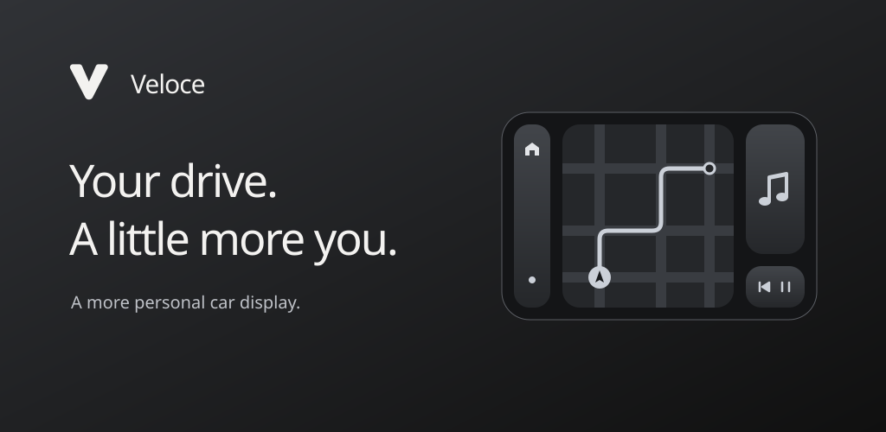

# Veloce


An independent Android car-projection client for Android 14+, without Google Play
services or root. USB and wireless connections share a launcher, AndroidX car-app
host, media browser, and playback-audio forwarding.

Veloce is experimental, not an official Android Auto client or a fully conformant
Car App Library host. Compatibility depends on the phone, head unit, and apps.

## Build

Open the project in Android Studio with Android SDK Platform 37 installed.
Gradle uses JDK 25; application and protocol bytecode target Java 17.

```sh
./gradlew :app:assembleDebug
./gradlew :protocol:test :app:testDebugUnitTest :app:lintDebug
```

The APK is at `app/build/outputs/apk/debug/app-debug.apk`.
`:app:assembleRelease` builds an optimized APK, unsigned unless release signing
is configured.

### Create a stable release key

Run these :
```sh
keytool -genkeypair -keystore "<path-to-store-key>/veloce.jks" -storetype JKS -alias veloce -keyalg RSA -keysize 4096 -validity 10000
chmod 600 "<path-to-store-key>/veloce.jks"
```

Put these properties in **`~/.gradle/gradle.properties`** :

```properties
veloce.storeFile=<absolute-path-to-store-key>/veloce.jks
veloce.storePassword=YOUR_STORE_PASSWORD
veloce.keyAlias=veloce
veloce.keyPassword=YOUR_KEY_PASSWORD
```

## Limitations

The car-app host supports common list, grid, pane, message, search, tab, and navigation
templates up to Car App API 7, with fixed night mode. Microphone/assistant input,
car telemetry, cluster forwarding, notification replies, and read-aloud are absent.
Hardware requests receive explicit unsupported results.
Navigation speech and calls are separate from playback capture.

## Project

- `app/`: Android UI, transports, projection, app hosting, media, and notifications.
- `protocol/`: Android-independent framing, TLS, and projection session engine.
- [Architecture and references](docs/ARCHITECTURE.md).

License selection is pending. No open-source license is granted by this repository yet.

## Publishing artwork

Adaptive and monochrome Android icons, splash artwork, and the in-app mark share
the same branding. Store-ready icon and feature-graphic exports, with SVG sources,
are in [`branding/`](branding/README.md).
